<div align="center">


# Meetora

**Video meetings that feel like you're in the room.**

Peer-to-peer video calls in the browser with live captions, reactions, raised hands, screen sharing, host controls and a recap of every session.

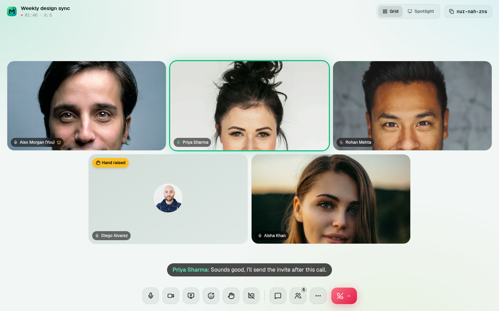

</div>

---

## What's new in 2.0

Meetora 2.0 is a full redesign and rebuild of a basic course project ("MeetUp").

| Area | 1.0 | 2.0 |
|---|---|---|
| Design | Light Tailwind pages with background images | "Emerald studio" design system: glass panels, aurora background, Geist; light by default with a dark mode toggle |
| Joining | Straight into the call | **Lobby** with camera preview, mic level meter, device pickers and who's already inside |
| In the call | Grid, mute, camera, chat | Adaptive grid + **spotlight/pin**, **active-speaker glow**, **screen sharing**, **reactions**, **raise hand**, **live captions**, people panel, settings, keyboard shortcuts |
| Host | End meeting (anyone could trigger it) | Host-only **end for all**, **ask to mute / mute all**, **remove participant** |
| Scheduling | None | **Schedule meetings**, countdown on the dashboard, invite links, Google Calendar links |
| History | Card list with chat log | Day-grouped history with search and filters, **attendance timeline**, **searchable transcript** with .txt export, copyable summary |
| Dashboard | Clock + plan badge | Bento dashboard: stats, 7-day activity chart, "your circle", up next, upcoming, recent sessions, plan usage |
| Security | Sockets trusted the client's user id | Every socket verifies a Clerk session token; host checks and room scoping on the server; 26 automated security checks |

## Features

**Meetings**
- Instant meetings with readable codes (`abc-def-ghi`), or schedule one for later. Scheduled meetings start when the first person joins.
- Join by typing a code or pasting an invite link; the code formats itself as you type.
- Pre-join lobby: preview your camera, test your mic with a live meter, switch devices, see who's already in the room.
- Clear guidance when camera/mic permission is blocked, missing or in use. You can still join to listen and chat.

**In the call**
- Adaptive grid that fits the largest possible tiles to your window; spotlight layout with pinning; presenters are spotlighted automatically.
- Active-speaker glow from real audio levels (WebRTC receiver `audioLevel` for others, Web Audio for your own mic).
- Screen sharing (tab, window or screen) using `replaceTrack`, so nothing renegotiates.
- Emoji reactions that float up with the sender's name; raise hand with badges, sorting and toasts.
- **Live captions** using the browser's speech recognition (Chrome, Edge, Safari): your words appear as subtitles for everyone and each sentence is saved to the session transcript. Captions only run while your mic is unmuted.
- Chat with history, grouped bubbles, unread badge and message toasts.
- People panel; hosts can ask one person or everyone to mute, and remove participants (who can't rejoin).
- Settings for camera, microphone, speaker, noise suppression and mirrored self-view, all switchable mid-call. Turning the camera off releases it, so the camera light goes off.
- Keyboard shortcuts: `M` mute, `V` camera, `H` hand, `L` captions, `C` chat, `P` people, `G` layout, `1`–`8` reactions, `?` help.
- After the call, a recap card with time in the call, people and messages, plus Rejoin and View recap.

**Dashboard and history**
- Greeting with live clock, New meeting / Schedule / Join, "Your circle" (people you meet most).
- Up next card with countdown; live banner when one of your meetings has people in it.
- Stats (meetings, hours in calls, people met, messages) and a 7-day time-in-meetings chart.
- Upcoming meetings: copy link, add to Google Calendar, cancel, start.
- Sessions grouped by day with search and Hosted/Joined filters; recap modal with attendance timeline, transcript search and download, chat log, summary copy and delete.

**Everywhere**
- Light theme by default with a dark mode toggle (remembered per browser, no flash on load), responsive from 390px phones to wide desktops, `prefers-reduced-motion` support, skeleton loaders, empty states, toasts, aria labels on icon buttons.

## Screenshots

| | |
|---|---|
| 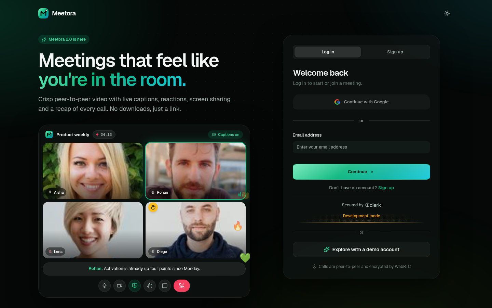 | 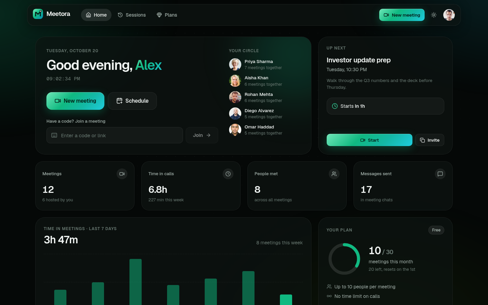 |
| Auth: live call preview and Clerk sign-in | Dashboard: stats, activity, upcoming, recent |
| 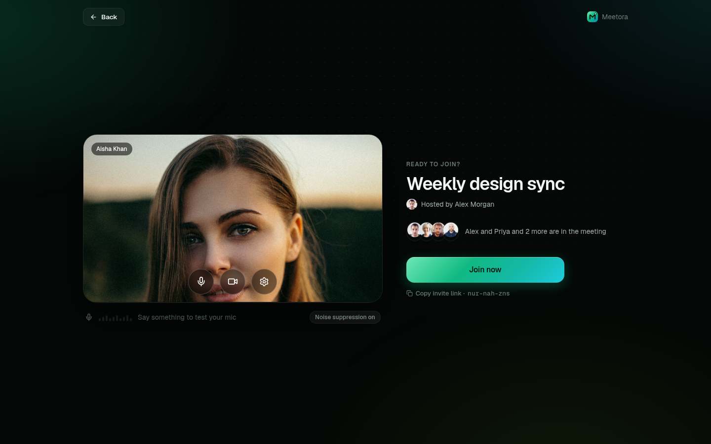 | 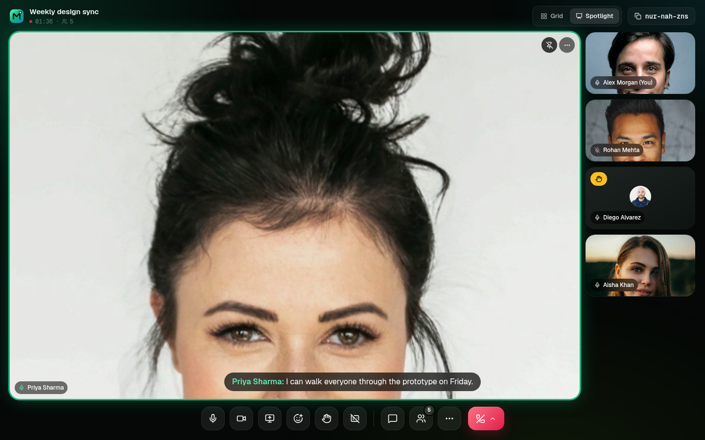 |
| Lobby: preview, mic meter, who's inside | Spotlight with active-speaker glow and captions |
| 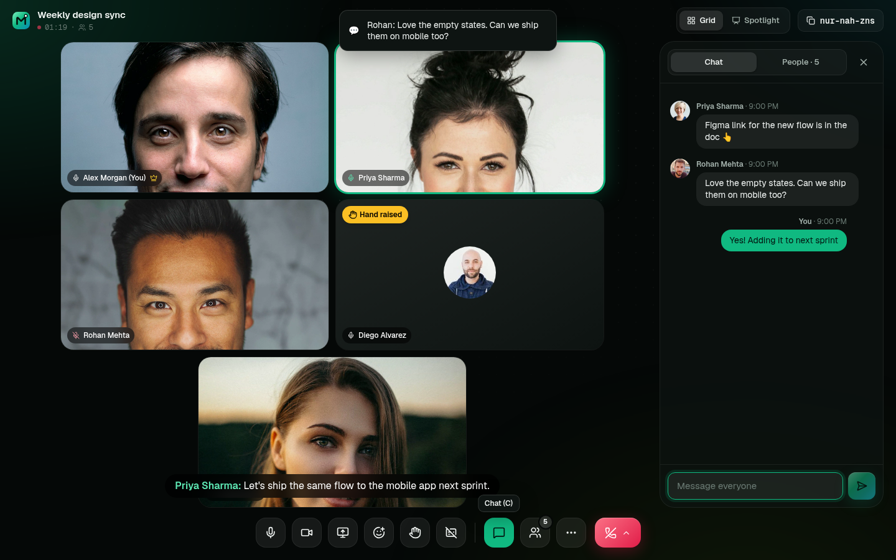 | 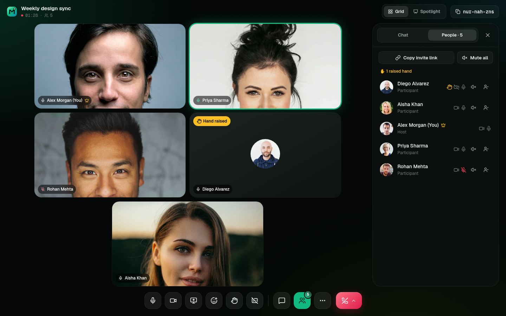 |
| Chat panel with message toasts | People panel with host controls |
| 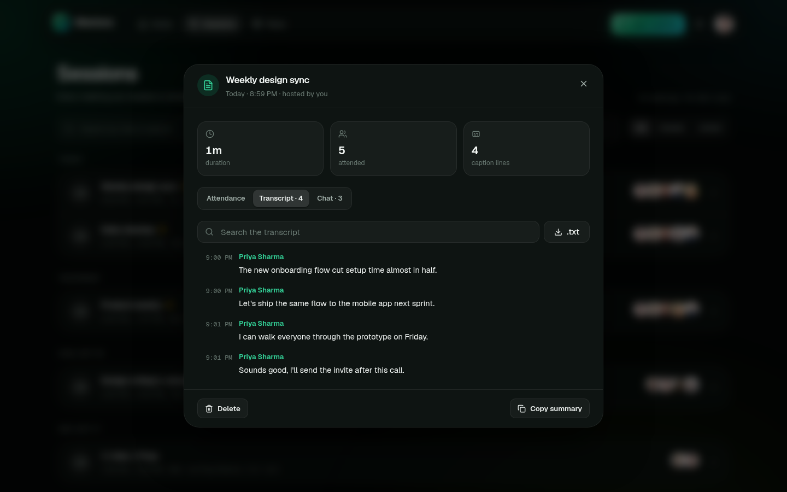 | 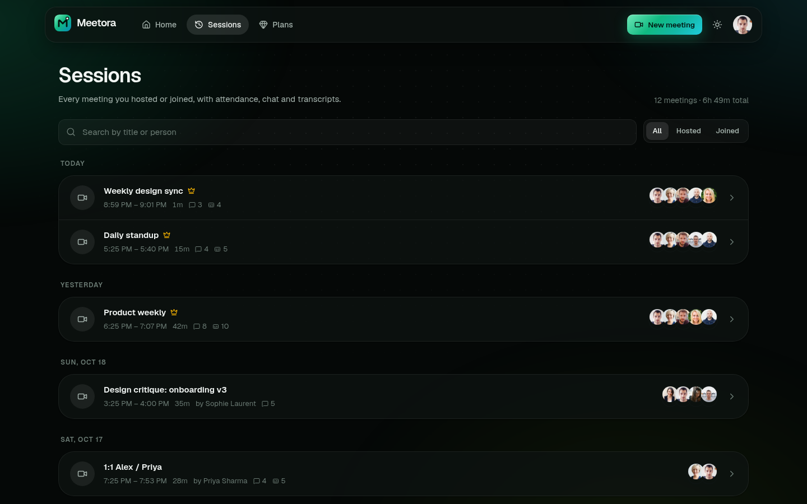 |
| Recap: searchable live-caption transcript | Session history grouped by day |
| 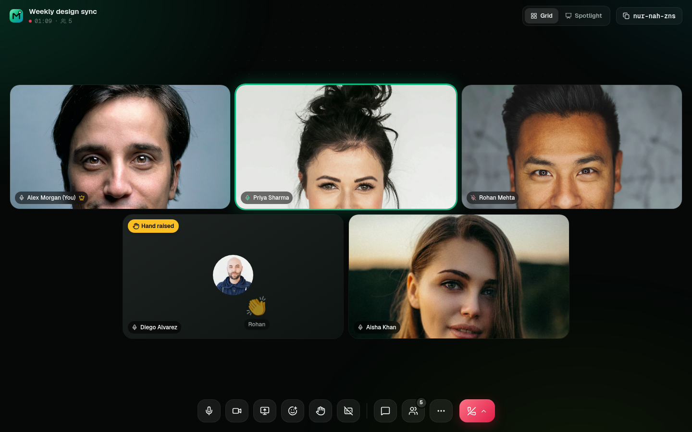 | 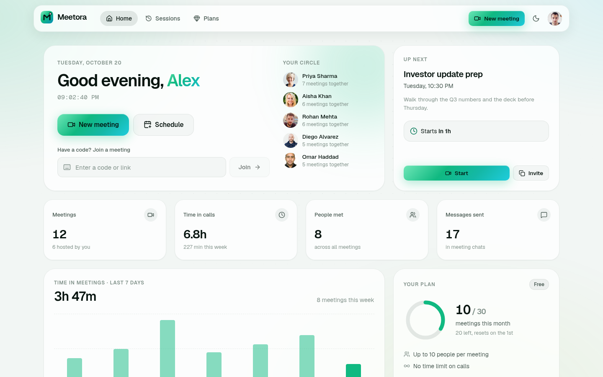 |
| Dark mode in a call | Light (default) dashboard |

<p align="center">
  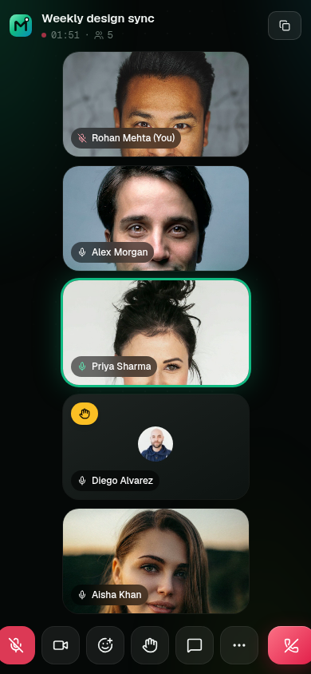
  &nbsp;&nbsp;
  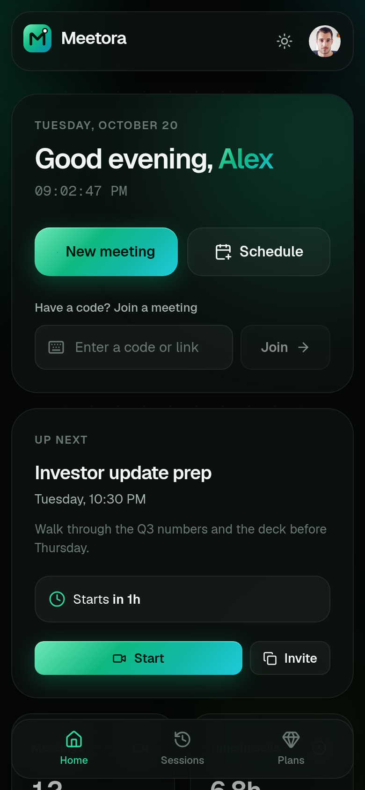
  &nbsp;&nbsp;
  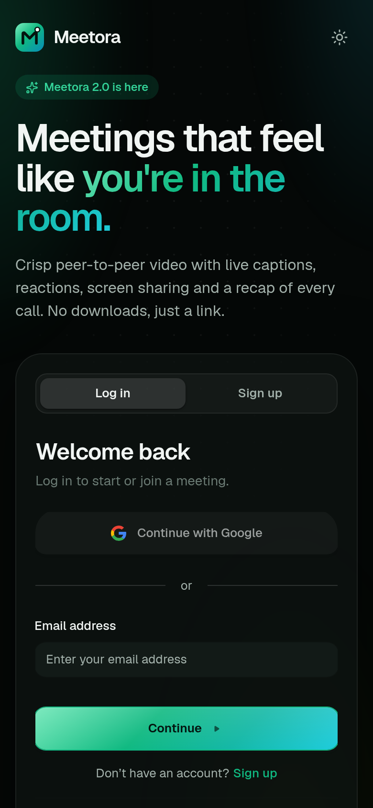
</p>

## Tech stack

| Layer | Tech |
|---|---|
| Client | React 19, Vite 8, React Router 7, Tailwind CSS 4 (with CSS-variable design tokens), lucide-react, react-hot-toast |
| Auth | Clerk (`@clerk/react` on the client, `@clerk/express` + `@clerk/backend` on the server) |
| Real time | WebRTC (full mesh, STUN + optional TURN), Socket.io for signaling and room events |
| Captions | Web Speech API (`SpeechRecognition`) in the browser |
| Server | Node.js, Express 5, Socket.io 4 |
| Database | Neon serverless Postgres (`@neondatabase/serverless`) |
| Tooling | oxlint, Playwright-driven end-to-end checks, `npm run test:security` |

## Project structure

```
meetora/
├── client/                    # React app
│   ├── src/
│   │   ├── pages/             # Auth, Dashboard, Sessions, Plans, MeetingRoom
│   │   ├── components/
│   │   │   ├── ui/            # Logo, Avatar, Modal, EmptyState, ThemeToggle
│   │   │   ├── auth/          # animated call preview
│   │   │   ├── dashboard/     # join form, schedule modal, chart, stat tiles, lists
│   │   │   ├── meeting/       # Lobby, Stage, VideoTile, ControlBar, SidePanel, overlays, PostCall
│   │   │   └── sessions/      # recap modal (attendance, transcript, chat)
│   │   ├── hooks/             # useMeeting (WebRTC + sockets), useLocalMedia, useLiveCaptions, useAudioLevel ...
│   │   ├── lib/               # theme, format, meetings, ICE config, audio level, Clerk appearance
│   │   └── index.css          # design tokens and primitives
│   └── vercel.json            # SPA rewrites
├── server/                    # API + signaling
│   ├── server.js
│   ├── socket.js              # authenticated Socket.io: signaling, chat, reactions, captions, host controls
│   ├── controllers/           # meetings, stats, sessions, Clerk webhook
│   ├── routes/                # /api/meetings, /api/demo
│   ├── middleware/auth.js     # Clerk-protected routes
│   ├── lib/                   # users, live room state
│   ├── config/db.js           # Neon connection + schema
│   └── scripts/               # seed.mjs, security-test.mjs
├── docs/screenshots/
└── package.json               # run everything from the root
```

## Getting started

### Prerequisites

- Node.js 20.9+
- A free [Clerk](https://dashboard.clerk.com) application (Email + Google sign-in)
- A free [Neon](https://console.neon.tech) Postgres database

### 1. Clone and install

```bash
git clone https://github.com/Yusuf-Hussain25/meetora.git
cd meetora
npm install            # root helper (concurrently)
npm run install:all    # server + client dependencies
```

### 2. Configure `.env`

```bash
cp server/.env.example server/.env
cp client/.env.example client/.env
```

| File | Key | Where to find it |
|---|---|---|
| `server/.env` | `DATABASE_URL` | Neon → your project → **Connect** → connection string |
| `server/.env` | `CLERK_PUBLISHABLE_KEY`, `CLERK_SECRET_KEY` | Clerk → **Configure → API keys** |
| `server/.env` | `ORIGINS` | URLs allowed to call the API (e.g. `http://localhost:5173`) |
| `server/.env` | `DEMO_EMAIL`, `DEMO_PASSWORD`, `SEED_PASSWORD` | Your choice; used by `npm run seed` |
| `server/.env` | `CLERK_WEBHOOK_SIGNING_SECRET` | Optional. Clerk → **Webhooks** (users are also created on first request) |
| `client/.env` | `VITE_BASE_URL` | URL of the server (`http://localhost:3000`) |
| `client/.env` | `VITE_CLERK_PUBLISHABLE_KEY` | Same publishable key as above |
| `client/.env` | `VITE_DEMO_EMAIL` | Optional. Shows "Explore with a demo account" |

If a required client key is missing, the app shows a setup screen listing exactly which keys to add instead of a blank page.

### 3. Run

```bash
npm run dev    # API on http://localhost:3000 + web app on http://localhost:5173
```

The server creates and migrates its tables on start. Open two browsers (or a normal and a private window) with two accounts to try a call.

### 4. Security checks

With the server running:

```bash
npm run test:security
```

This creates throwaway Clerk users and checks 26 rules with real sessions: anonymous and forged sockets are rejected, identity can't be spoofed, signaling and meeting-ended events stay inside their room, only the host can end, mute or remove, removed people can't rejoin, session details are private to participants, and reactions and captions are validated and stored as the verified user. Test users are deleted afterwards.

## Configurable providers

| Setting | Default | Options |
|---|---|---|
| `VITE_ICE_SERVERS` (client) | Google STUN | JSON array of extra ICE servers, e.g. a TURN server for strict corporate or mobile networks: `[{"urls":"turn:turn.example.com:3478","username":"u","credential":"p"}]` |
| `VITE_CLERK_BILLING` (client) | `false` | `true` after creating a `premium` plan in Clerk Billing: shows Clerk's PricingTable on the Plans page, and the server syncs the plan (unlimited meetings, 100 people) |
| `VITE_DEMO_EMAIL` (client) + `DEMO_EMAIL` (server) | unset | Enables one-click demo sign-in. The server issues a one-time Clerk sign-in ticket for that account only, so no password is shipped to the browser |

Calls use a full mesh (everyone connects to everyone), which works best for small meetings of up to about 6–8 people.

## Demo data

```bash
npm run seed                          # demo account + 8 teammates + meetings
npm run seed -- --with you@email.com  # also add your own account to the meetings
```

The seeder creates Clerk accounts on `@meetora-demo.dev` with profile photos (randomuser.me), 11 past meetings over two weeks (staggered joins, early leaves, chat and caption transcripts) and 4 upcoming scheduled meetings. It's safe to re-run: users are reused and meetings have stable codes, so nothing is duplicated. Log in with "Explore with a demo account" or with `DEMO_EMAIL` / `DEMO_PASSWORD`.

## Deployment

**Client on Vercel.** Import the repo, set the root directory to `client/`, add the `VITE_*` variables, deploy. `client/vercel.json` rewrites every route to `index.html` for client-side routing.

**Server on a host with long-lived WebSockets** (Render, Railway, Fly.io; serverless functions can't keep Socket.io connections open):

1. Root directory `server/`, build `npm install`, start `npm start`.
2. Add the server variables, with `ORIGINS` set to your Vercel URL.
3. Point `VITE_BASE_URL` in the client to the server URL and redeploy the client.
4. In Clerk, add your production domain, and optionally a webhook to `<server-url>/api/clerk`.

## Author

**Yusuf Hussain** · [github.com/Yusuf-Hussain25](https://github.com/Yusuf-Hussain25)
